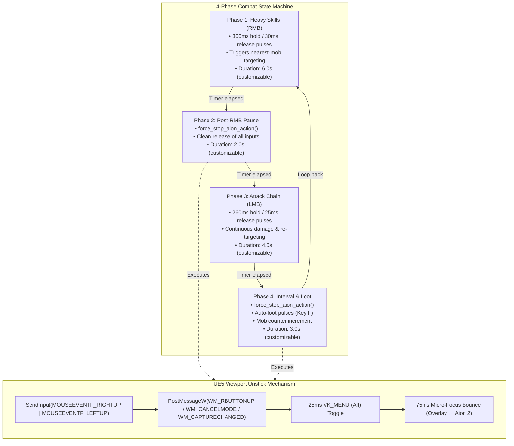

<div align="center">


# Aion 2 Combat Bot & Obsidian HUD

Autonomous rhythmic combat bot, in-game real-time HUD, and Unreal Engine 5 input controller designed specifically for **Aion 2** (`AION2.exe`).

[](https://en.wikipedia.org/wiki/C99)
[-2ED573.svg?style=flat-square)](https://bellard.org/tcc/)
[](https://www.unrealengine.com/)
[](https://www.microsoft.com/windows)
[]()
[]()

</div>

---

## Overview

Aion 2 Combat Bot is a native Windows utility written in **pure C99 using the Win32 API and GDI double-buffering**. It features zero external runtime dependencies (no Python, Electron, or heavy frameworks), runs at **< 0.1% CPU consumption**, and produces a standalone **~56 KB executable**.

The bot orchestrates a decoupled **4-Phase Autonomous Combat Flow** that aligns with Aion 2's native target-acquisition mechanics (nearest-mob auto-locking on attack keys) while resolving complex driver-level input latching issues in Unreal Engine 5 Action Combat.

> [!NOTE]
> The overlay renders directly over borderless and windowed game clients using `WS_EX_LAYERED` translucency, providing interactive controls, live session telemetry, and an in-HUD configuration drawer without dropping frame rates.

---

## Key Features

- **4-Phase Autonomous Combat Rotation:** Rhythmic cycling between heavy RMB bursts, cooldown recovery pauses, basic LMB attack chains, and looting intervals.
- **Unreal Engine 5 Unlatch Technology:** Proprietary `force_stop_aion_action()` mechanism that clears synthetic button latching in UE5 viewport capture during pauses and phase transitions.
- **Real-Time In-HUD Configuration Drawer:** Interactive expandable drawer (`F10` / `[⚙ CFG]`) for live tuning of phase timers, cooldowns, and hotkeys without restarting.
- **Single-Instance Enforcement:** Named system mutex and window enumeration to prevent accidental duplicate bot processes.
- **Obsidian Glassmorphism HUD:** Non-intrusive 9-slot floating overlay with real-time status indicators, farm telemetry (mobs/hr counter), session timer, and click-to-toggle slots.
- **Hardware ScanCode Pipeline:** Bypasses low-level keyboard/mouse hooks (`WH_KEYBOARD_LL`) via synchronized `PostMessageW` and `KEYEVENTF_SCANCODE` events.
- **Dynamic Config Persistence:** Automatically saves settings to `config.ini` whenever adjusted in-game or manually edited.

---

## Combat Flow Architecture

The combat worker thread runs decoupled from the Win32 message loop, driving a synchronized 4-phase state machine:



---

## Technical Deep-Dive

### 1. Unreal Engine 5 Viewport Input Latching

#### The Challenge
In Unreal Engine 5 Action Combat (`bUsingHighPrecisionMouseInput = true`), raw synthetic mouse holds across several seconds can cause the game's internal `PressedMouseButtons` map to desynchronize from the Windows input queue. When synthetic `MOUSEEVENTF_RIGHTUP` is sent, UE5's viewport capture can ignore the release, causing the character to continuously channel abilities or auto-attack even during designated rest intervals or when paused (`F8`).

#### The Solution
The bot implements `force_stop_aion_action()` during every rest phase and pause event:
1. **Clean Hardware Release:** Emits explicit `SendInput` mouse-up events with zero movement deltas.
2. **Direct Window Messages:** Posts `WM_RBUTTONUP`, `WM_LBUTTONUP`, `WM_CANCELMODE`, and `WM_CAPTURECHANGED` directly to the `UnrealWindow` message queue.
3. **Cursor Lock Cycle:** Sends a brief 25ms `VK_MENU` (Alt) key event to toggle Action Mode cursor capture.
4. **Micro-Focus Reset:** Performs a transparent 75ms focus switch to the topmost overlay (`g_hWnd`) and immediately restores focus to `AION2.exe`. This signals `WM_ACTIVATE(WA_INACTIVE)` to UE5, triggering its native internal `FlushPressedKeys()` without flickering or interrupting the player's view.

### 2. Micro-Pulse Target Acquisition

Aion 2 binds target-closest-enemy to primary attack inputs. Holding a mouse button down as a static continuous press prevents the target acquisition trigger from refiring after a mob dies.

The bot employs high-frequency micro-pulsing:
- **RMB Phase:** 300ms hold down followed by 30ms release.
- **LMB Phase:** 260ms hold down followed by 25ms release.

This produces smooth skill casting chains while repeatedly asserting target acquisition so the character automatically pivots to the next closest monster.

### 3. Single-Instance Protection

To protect system resources and avoid conflicting input loops, `WinMain` initializes a named kernel mutex:

```c
HANDLE hMutex = CreateMutexW(NULL, TRUE, L"Local\\Aion2_CombatBot_SingleInstance_Mutex");
if (GetLastError() == ERROR_ALREADY_EXISTS) {
    HWND hExisting = FindWindowW(L"Aion2_CombatBot_Class", NULL);
    if (hExisting) {
        SetForegroundWindow(hExisting);
        FlashWindow(hExisting, TRUE);
    }
    return 0;
}
```

---

## Obsidian In-Game HUD

The HUD is a floating glassmorphic bar positioned in the bottom-right corner of the screen:

| Slot | Label / Control | Functionality |
| :---: | :--- | :--- |
| **1** | `[AION 2]` | Brand badge and drag handle for repositioning |
| **2** | `[COMBATE: ATIVO / PAUSADO]` | Global bot state (Click or press `F8` to toggle) |
| **3** | `[FASE X: RMB / LMB / PAUSA]` | Live phase indicator with color-coded status badges |
| **4** | `[⚔ 0 MOBS (0/h)]` | Real-time kill count and hourly farm efficiency rate |
| **5** | `[⏱ 00:00]` | Active session timer (`MM:SS` or `HH:MM:SS`) |
| **6** | `[CURA [Q]: ON / OFF]` | Auto-heal support skill toggle (`F6`) |
| **7** | `[LOOT [F]: ON / OFF]` | Auto-loot key pulse toggle (`F7`) |
| **8** | `[⚙ CFG [F10]]` | Expands / collapses the real-time configuration drawer |
| **9** | `[✕]` | Graceful shutdown with input cleanup |

### In-HUD Configuration Drawer (`F10`)
Pressing `F10` or clicking `[⚙ CFG]` slides open an integrated options panel directly inside the overlay. You can adjust:
- **Phase 1 Duration:** RMB combat duration (seconds).
- **Phase 2 Duration:** Post-RMB pause duration (seconds).
- **Phase 3 Duration:** LMB combat duration (seconds).
- **Phase 4 Duration:** Cooldown & loot interval (seconds).
- **Auto-Heal Interval & Hotkey:** Health maintenance trigger rate.

Changes apply immediately in memory and are written to `config.ini`.

---

## Global Hotkeys

| Hotkey | Action | Audio Feedback |
| :---: | :--- | :--- |
| **`F8`** | **Start / Pause Combat** | High Beep (1200 Hz) / Low Beep (600 Hz) |
| **`F6`** | **Toggle Auto-Heal (`Q`)** | Chime (900 Hz) |
| **`F7`** | **Toggle Auto-Loot (`F`)** | High Beep (1100 Hz) / Low Beep (550 Hz) |
| **`F9`** | **Window Guard Mode (Aion 2 only vs Any window)** | Alert (1000 Hz / 800 Hz) |
| **`F10`** | **Toggle Configuration Drawer** | Click tone |
| **`F12`** | **Exit & Force Release Inputs** | Immediate termination |

---

## Configuration (`config.ini`)

On startup, the bot creates or loads `config.ini` in the application directory:

```ini
[Combate]
RMB_Hold_Seconds=6.0        ; Phase 1: Heavy attack duration
Wait_After_RMB_Seconds=2.0  ; Phase 2: Rest pause
LMB_Hold_Seconds=4.0        ; Phase 3: Attack chain duration
Wait_After_LMB_Seconds=3.0  ; Phase 4: Loot & recovery interval
AutoHeal=1                  ; 1 = Enabled, 0 = Disabled
Heal_CooldownMs=3500        ; Heal trigger interval (ms)
AutoLoot=1                  ; 1 = Enabled, 0 = Disabled
LootPressCount=2            ; Key presses per loot cycle

[Teclas]
KeyHeal=Q                   ; Support / Heal key
KeyLoot=F                   ; Loot interaction key

[Overlay]
WindowGuard=1               ; 1 = Lock execution to AION2.exe, 0 = Free mode
PosX=-1                     ; Custom X coordinate (-1 = default)
PosY=-1                     ; Custom Y coordinate (-1 = default)
```

---

## Project Structure

```text
aion2-bot/
├── main.c               # Core Win32 C99 application (HUD, Worker & UE5 unstick logic)
├── config.ini           # Persistent user settings and timings
├── build.bat            # 1-Click build script (TCC + Manifest + Multi-res Icon)
├── inject_manifest.py   # Injects UAC requireAdministrator manifest into PE header
├── tools_inject_icon.py # Embeds multi-resolution ICO (16x16 up to 256x256)
├── aion2.ico            # Official high-resolution icon resource
├── Aion2_Bot.exe        # Standalone compiled binary (~56 KB)
├── .gitignore           # Git ignore definitions for logs and build artifacts
└── README.md            # Technical documentation
```

---

## Build Instructions

The application is compiled using the **Tiny C Compiler (TCC)** for instant build cycles and minimal binary footprint.

### Prerequisites
- Windows 10 or 11 (x64)
- [Tiny C Compiler (TCC)](https://bellard.org/tcc/)
- Python 3.x (used during build to inject PE icon resources and UAC elevation manifest)

### Compiling via `build.bat`
Run the included batch script from Command Prompt or PowerShell:

```cmd
build.bat
```

### Manual Compilation
```cmd
:: 1. Compile C source to executable
tcc main.c -o "Aion2_Bot.exe" -lgdi32 -luser32 -lkernel32 -mwindows

:: 2. Inject UAC Administrator manifest
python inject_manifest.py

:: 3. Embed multi-resolution icon resources
python -c "import tools_inject_icon; tools_inject_icon.inject_ico('Aion2_Bot.exe', 'aion2.ico')"
```

---

## Quickstart

1. Launch **`Aion2_Bot.exe`** as Administrator.
2. The Obsidian HUD will dock at the bottom-right corner of your desktop.
3. Switch to your **Aion 2** game client (Windowed or Borderless Windowed mode).
4. Press **`F8`** to activate the combat loop.
5. Press **`F10`** at any point to fine-tune phase durations to match your class skill rotation.
6. Press **`F8`** again to pause or **`F12`** to exit.

> [!IMPORTANT]
> Always run the bot as Administrator. Windows user interface privilege isolation (UIPI) prevents non-elevated applications from sending synthetic inputs to games running with administrative privileges.

> [!TIP]
> If your class uses skills with longer cooldowns, open the in-HUD drawer (`F10`) and increase **Phase 1** or **Phase 4** duration to synchronize with your skill animation timings.
