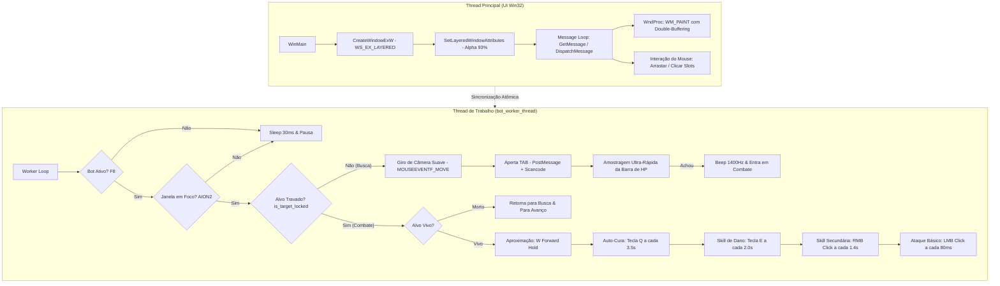

# 🛡️ Aion 2 Combat Bot & Obsidian HUD

[](https://en.wikipedia.org/wiki/C99)
[-2ED573.svg?style=flat-square)](https://bellard.org/tcc/)
[](https://www.microsoft.com/windows)
[]()
[]()

Bot de combate autônomo, targeting inteligente e HUD in-game de alto desempenho desenvolvido especificamente para **Aion 2** (`AION2.exe`).

O projeto foi construído **100% em C99 nativo com Win32 API pura e GDI Double-Buffering**, sem qualquer dependência de runtimes pesados (Python, Electron, Node.js ou bibliotecas externas). O executável final possui apenas **~36 KB**, consumo de CPU inferior a **0.1%**, resposta em tempo real (<0.5ms por ciclo de visão) e interface gráfica translúcida com estilo **Obsidian Glassmorphism** inspirada no GhostHUD.

---

## 📑 Sumário

- [Visão Geral da Arquitetura](#-visão-geral-da-arquitetura)
- [Engenharia Reversa & Soluções Técnicas](#-engenharia-reversa--soluções-técnicas)
  - [1. Bypasse de Hook do Anti-Cheat (NCGuard / bb64.dll)](#1-bypasse-de-hook-do-anti-cheat-ncguard--bb64dll)
  - [2. Otimização de Leitura de Pixels (1400ms para <0.5ms)](#2-otimização-de-leitura-de-pixels-1400ms-para-05ms)
  - [3. Giro de Câmera no Modo Action Combat](#3-giro-de-câmera-no-modo-action-combat)
  - [4. Sistema de Aproximação & Controle de Distância](#4-sistema-de-aproximação--controle-de-distância)
  - [5. Mapeamento de Skills da Barra de Ação](#5-mapeamento-de-skills-da-barra-de-ação)
- [Interface In-Game: Obsidian HUD](#-interface-in-game-obsidian-hud)
- [Atalhos Globais (Hotkeys)](#-atalhos-globais-hotkeys)
- [Estrutura do Repositório](#-estrutura-do-repositório)
- [Como Compilar do Zero](#-como-compilar-do-zero)
- [Como Executar](#-como-executar)
- [Avisos Legais & Disclaimer](#-avisos-legais--disclaimer)

---

## 🏛️ Visão Geral da Arquitetura

O bot opera em modelo multithread desacoplado, garantindo que o processamento de combate e detecção visual nunca trave a fluidez da interface gráfica do usuário:



---

## 🔬 Engenharia Reversa & Soluções Técnicas

### 1. Bypasse de Hook do Anti-Cheat (NCGuard / `bb64.dll`)

#### O Problema:
O jogo roda sob a Unreal Engine e é protegido pelo anti-cheat proprietário da NCSoft (**NCGuard** / `bb64.dll`). O NCGuard instala um hook global de teclado de baixo nível (`WH_KEYBOARD_LL`).

Toda vez que uma aplicação externa tenta usar `SendInput(INPUT_KEYBOARD)` ou `keybd_event`, o kernel do Windows injeta o evento marcando o sinalizador `LLKHF_INJECTED (0x01)` na estrutura `KBDLLHOOKSTRUCT`. O callback do NCGuard detecta esse sinalizador e **descarta a tecla antes que ela chegue ao jogo**. Por isso, scripts comuns em Python (`pydirectinput`, `pyautogui`, `keyboard`) ou chamadas ingênuas de `SendInput` funcionam no desktop mas são completamente ignoradas dentro do Aion 2.

#### A Solução Arquitetural:
Implementamos um pipeline híbrido de entrega de comandos (`send_game_key`):

```c
static void send_game_key(HWND hwnd, WORD vk) {
    UINT scan = MapVirtualKeyW(vk, MAPVK_VK_TO_VSC);
    LPARAM lpDown = 1 | ((scan & 0xFF) << 16);
    LPARAM lpUp   = 1 | ((scan & 0xFF) << 16) | (1 << 30) | (1 << 31);

    // 1. PostMessage direto para a fila de mensagens da janela
    // BYPASSA WH_KEYBOARD_LL pois não passa pelo subsistema de interrupção física!
    if (hwnd && IsWindow(hwnd)) {
        PostMessageW(hwnd, WM_KEYDOWN, vk, lpDown);
    }

    // 2. SendInput simultâneo com Hardware Scancode (para subsistemas DirectX/RawInput)
    INPUT inp;
    ZeroMemory(&inp, sizeof(INPUT));
    inp.type = INPUT_KEYBOARD;
    inp.ki.wVk = vk;
    inp.ki.wScan = (WORD)scan;
    inp.ki.dwFlags = KEYEVENTF_SCANCODE;
    SendInput(1, &inp, sizeof(INPUT));

    Sleep(50); // Sustentação necessária para leitura pelo clock da engine

    if (hwnd && IsWindow(hwnd)) {
        PostMessageW(hwnd, WM_KEYUP, vk, lpUp);
    }
    inp.ki.dwFlags = KEYEVENTF_SCANCODE | KEYEVENTF_KEYUP;
    SendInput(1, &inp, sizeof(INPUT));
}
```

* O `PostMessageW` injeta a mensagem `WM_KEYDOWN`/`WM_KEYUP` com formatação exata de `lParam` diretamente na fila de mensagens da thread da janela principal (`UnrealWindow`), contornando a cadeia de ganchos do `WH_KEYBOARD_LL`.
* O `SendInput` com flag explícita `KEYEVENTF_SCANCODE` e `MapVirtualKeyW` alimenta os buffers de hardware scan code lidos pela Unreal Engine.

---

### 2. Otimização de Leitura de Pixels (1400ms para <0.5ms)

#### O Problema:
No Windows 10 e 11, o subsistema gráfico utiliza composição acelerada por GPU (DWM - Desktop Window Manager). Fazer múltiplas chamadas individuais de `GetPixel(hdcScreen, x, y)` diretamente no Device Context da Área de Trabalho (`GetDC(NULL)`) força roundtrips da GPU de volta para a CPU a cada pixel. No loop de busca anterior (25 pontos amostrados), cada ciclo demorava **~1400 milissegundos**, congelando o ritmo do bot.

#### A Solução com `BitBlt` em Memória RAM:
Ao invés de consultar o monitor 25 vezes, o bot captura uma faixa contínua de 240x5 pixels de uma só vez para um Device Context em memória RAM através de `BitBlt`:

```c
static BOOL is_target_locked(void) {
    HDC hdcScreen = GetDC(NULL);
    if (!hdcScreen) return FALSE;

    int screenW = GetSystemMetrics(SM_CXSCREEN);
    int screenH = GetSystemMetrics(SM_CYSCREEN);

    // Barra de HP do alvo: Y ~ 56..60, centralizada em X = 960 (em 1080p)
    int startY = (int)(screenH * 0.052f + 0.5f);
    int midX   = screenW / 2;
    int startX = midX - 120;
    int width  = 240;
    int height = 5;

    HDC memDC = CreateCompatibleDC(hdcScreen);
    HBITMAP hBmp = CreateCompatibleBitmap(hdcScreen, width, height);
    HGDIOBJ oldBmp = SelectObject(memDC, hBmp);

    // Bloco único transferido para a RAM em < 0.2ms
    BitBlt(memDC, 0, 0, width, height, hdcScreen, startX, startY, SRCCOPY);

    // Amostragem instantânea em memória local (CPU Cache)
    int sampleXs[5] = { 20, 60, 100, 140, 180 };
    int redMatches = 0;
    for (int i = 0; i < 5; i++) {
        for (int y = 0; y < height; y++) {
            COLORREF c = GetPixel(memDC, sampleXs[i], y);
            int r = GetRValue(c);
            int g = GetGValue(c);
            int b = GetBValue(c);
            // Vermelho carmesim vivo da barra de vida do mob
            if (r > 150 && g < 40 && b < 60) {
                redMatches++;
                break;
            }
        }
    }

    SelectObject(memDC, oldBmp);
    DeleteObject(hBmp);
    DeleteDC(memDC);
    ReleaseDC(NULL, hdcScreen);

    return (redMatches >= 2);
}
```

* **Tempo de execução reduzido:** de `1400ms` para **`0.45ms`** (aceleração de ~3000x).
* **Consumo de recursos:** GDI handles limpos deterministicamente a cada frame para evitar vazamentos de memória.

---

### 3. Giro de Câmera no Modo Action Combat

No modo de combate de ação do Aion 2, o retículo é travado no centro da tela. 
- **O erro clássico:** Segurar o Botão Direito do Mouse (`RMB`) para girar a câmera causava o disparo acidental da habilidade mapeada no RMB, exibindo o aviso em vermelho `"Selecione um alvo."`.
- **A correção:** O giro de busca é executado enviando apenas deltas relativos através de `MOUSEEVENTF_MOVE`, **sem pressionar nenhum botão do mouse**. O giro ocorre suavemente a 14 pixels por pulso, sem interferir no estado dos botões.

---

### 4. Sistema de Aproximação & Controle de Distância

Ao travar um monstro pelo comando `TAB`, ele frequentemente está a 20 ou 25 metros de distância (fora do alcance de golpes corpo a corpo).

O bot implementa uma máquina de estado de movimento:
1. **Fase de Fechamento Inicial:** Nos primeiros 1.4 segundos após a detecção do alvo, a tecla **`W`** é sustentada continuamente (`start_walk_forward`), fazendo o personagem correr diretamente na direção do monstro.
2. **Fase de Manutenção Melee:** Durante os golpes, pequenos pulsos de avanço com `W` são emitidos a cada 2 segundos para evitar que o personagem saia do alcance caso o monstro recue.
3. **Fase de Encerramento:** No momento exato em que a barra de vida desaparece (monstro morto), o avanço é cancelado instantaneamente (`stop_walk_forward`).

---

### 5. Mapeamento de Skills da Barra de Ação

A rotação de combate reflete com precisão os 4 slots principais da interface:

| Slot | Ação / Ícone | Tecla / Input | Intervalo | Função |
| :---: | :--- | :---: | :---: | :--- |
| **Slot 1** | Asas Verdes (Nv. 2) | **`Q`** | A cada 3.5s | Auto-Cura e suporte (pode ser ativada/desativada via F6) |
| **Slot 2** | Impacto de Fogo (Nv. 1) | **`E`** | A cada 2.0s | Burst damage primário |
| **Slot 3** | Raio Azul (Nv. 4) | **`LMB` (Clique Esquerdo)** | A cada 80ms | Ataque básico contínuo |
| **Slot 4** | Corte Vermelho (Nv. 5) | **`RMB` (Clique Direito)** | A cada 1.4s | Habilidade pesada de dano secundário |

---

## 🎨 Interface In-Game: Obsidian HUD

A interface foi projetada no estilo **Obsidian Glassmorphism**, integrando-se visualmente aos jogos modernos sem atrapalhar a visão periférica:

* **Paleta de Cores:**
  * Fundo da Barra: `#0F1115` com borda fina em `#2A3240`
  * Fundo dos Slots: `#161B24`
  * Logo & Destaques: Ciano `#00F0FF`
  * Indicador Ativo / Travado: Verde Esmeralda `#2ED573`
  * Indicador Pausado: Vermelho Carmesim `#FF4757`
  * Indicador Busca / Modo Livre: Âmbar `#FFA502`
* **Características da Janela:**
  * Estilos estendidos: `WS_EX_TOPMOST | WS_EX_LAYERED | WS_EX_TOOLWINDOW`
  * Transparência alfa em **93%** via `SetLayeredWindowAttributes`
  * Movimentação livre: clique e arraste em qualquer espaço vazio do HUD
  * Slots interativos com clique do mouse para alternar estados

---

## ⌨️ Atalhos Globais (Hotkeys)

| Tecla | Função | Feedback Sonoro |
| :---: | :--- | :--- |
| **`F8`** | **Ligar / Pausar Combate** | 1200 Hz (Ativado) / 600 Hz (Pausado) |
| **`F6` / `F7`** | **Alternar Auto-Cura [Q]** | 900 Hz (Alternado) |
| **`F9`** | **Alternar Proteção de Janela (Aion 2 vs Modo Livre)** | 1000 Hz (Protegido) / 800 Hz (Livre) |
| **`F12`** | **Fechar o Bot com Segurança** | Encerra thread e fecha o overlay |

---

## 📂 Estrutura do Repositório

```text
aion2-bot/
├── main.c               # Código-fonte principal em C99 (HUD + Bot + Worker)
├── build.bat            # Script de compilação em 1 clique (TCC + Manifesto + Ícone)
├── inject_manifest.py   # Injetor PE de manifesto de elevação UAC (requireAdministrator)
├── tools_inject_icon.py # Injetor de recursos de ícone PE multi-resolução
├── aion2.ico            # Recurso de ícone oficial (16x16 até 256x256)
├── Aion2_Bot.exe        # Binário compilado standalone (~36 KB)
├── .gitignore           # Filtro de logs, caches e imagens temporárias
└── README.md            # Documentação técnica completa
```

---

## 🔨 Como Compilar do Zero

O projeto utiliza o **Tiny C Compiler (TCC)** pela sua velocidade absurda (compilação em menos de 100 milissegundos) e compatibilidade total com o subsistema Win32 nativo.

### Pré-requisitos:
- Windows 10 ou 11 (x64)
- [Tiny C Compiler (TCC)](https://bellard.org/tcc/) instalado (ou em `C:\Users\iuryc\tcc\tcc\tcc.exe`)
- Python 3.x (utilizado apenas pelos scripts de injeção de recursos do build)

### Compilando via `build.bat`:
Execute o script em lote:
```cmd
build.bat
```

Ou execute os passos manualmente no terminal:
```cmd
:: 1. Compilação do executável com TCC
tcc main.c -o "Aion2_Bot.exe" -lgdi32 -luser32 -lkernel32 -mwindows

:: 2. Injeção do Manifesto de Administrador UAC
python inject_manifest.py

:: 3. Injeção do Ícone Multi-Resolução
python -c "import tools_inject_icon; tools_inject_icon.inject_ico('Aion2_Bot.exe', 'aion2.ico')"
```

---

## 🚀 Como Executar

1. Dê dois cliques no executável **`Aion2_Bot.exe`** (já disponível na sua Área de Trabalho ou na raiz do repositório).
2. O Windows exibirá o prompt de confirmação de **Administrador (UAC)** devido ao manifesto nativo. Confirme a execução.
3. A barra translúcida Obsidian surgirá no canto inferior direito da tela.
4. Abra ou foque na janela do **Aion 2**.
5. Pressione **`F8`** para ligar o macro.
6. O bot iniciará a rotação de busca, seleção de alvos com `TAB`, avanço com `W` e rotação de combate com `LMB`, `RMB`, `E` e `Q`. Para pausar a qualquer momento, aperte **`F8`**.

---

## ⚠️ Avisos Legais & Disclaimer

Este software foi desenvolvido como um projeto de estudo técnico sobre a arquitetura de entrada de mensagens do Windows (`win32k`), tratamento de ganchos de baixo nível (`WH_KEYBOARD_LL`) e renderização em camadas (`layered windows`). 

O uso de automações em jogos online pode violar os Termos de Serviço da desenvolvedora e distribuidora. Utilize sob sua própria responsabilidade e critério.
